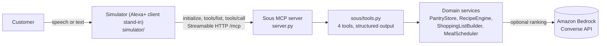

# Sous: an AI sous-chef for Alexa+

Sous is a self-hosted **MCP server** (spec `2025-11-25`, Streamable HTTP) that
turns Alexa+ into a sous-chef. Tell it what's in your kitchen, and it suggests
recipes that use what you have, tells you what's missing, and puts meals on
your plan. It remembers your pantry, restrictions, and allergies for the whole
conversation, so you never repeat yourself.

Built for the **Alexa+ track** (plus the **AWS Builder** mini challenge) of the
*Build, Ship, Shape: Amazon Developer Hackathon*.

```
You:   I have chicken breast, spinach, lemon and garlic, and I'm dairy-free
Sous:  Added chicken breast, spinach, lemon and garlic. I'll keep everything dairy-free.
You:   What can I cook tonight?
Sous:  Your best match is Lemon Spinach Chicken: you have 4 of 5 ingredients. You'd need olive oil.
You:   Schedule it for tomorrow at 7pm for 4 people
Sous:  Lemon Spinach Chicken is on your meal plan for tomorrow at 7pm, serving 4.
```

## How it works



| Tool | What it does | Annotations |
| --- | --- | --- |
| `update_pantry` | Adds or removes ingredients; sets restrictions and allergies; with no arguments, reads the pantry | updates state, idempotent |
| `find_recipes` | Filters the catalog by restrictions and allergies, ranks by pantry fit, returns have/missing per recipe | read-only |
| `build_shopping_list` | Lists what's still needed for a recipe | read-only |
| `schedule_meal` | Adds a recipe to the meal plan for a natural-language time | updates state |

**Design decisions**

- **Structured output for Alexa+ data-only rendering.** Every tool returns a
  dict published as `structuredContent` with an `outputSchema`, so a client can
  render native visuals instead of reading text aloud.
- **Session state.** Pantry, dietary profile, and meal plan are scoped to the
  MCP session (`MCP-Session-Id`). A new session starts clean.
- **Safety before ranking.** Restrictions and allergies are enforced
  deterministically *before* any ranking runs. The ranker, including the LLM,
  can only reorder recipes that are already safe.
- **Real errors.** Unknown recipe ids and invalid inputs return
  `isError: true` results, and arguments are validated against JSON Schema
  (for example, `servings` must be 1 to 20).
- **Thin tool layer.** `tools.py` only adapts MCP to the domain classes, which
  have no MCP code and are unit tested directly.

## Quick start

Requires Python 3.10 or newer.

```bash
python -m venv .venv
source .venv/bin/activate            # Windows: .venv\Scripts\activate
pip install -r requirements.txt -r simulator/requirements.txt
```

**1. Start the MCP server** (terminal 1):

```bash
python server.py                     # http://127.0.0.1:8000/mcp, health at /health
```

**2. Start the Alexa+ simulator** (terminal 2) and open http://127.0.0.1:8100:

```bash
python -m simulator
```

**3. Or run the scripted smoke test** against the server:

```bash
python test_client.py
```

Any MCP client works too, for example the MCP Inspector
(`npx @modelcontextprotocol/inspector`, transport Streamable HTTP, URL
`http://127.0.0.1:8000/mcp`).

## The Alexa+ simulator

Amazon's Alexa+ add-on tooling (MCP Toolkit, CLI, Web Simulator) is a preview
for select partners and isn't available to hackathon participants, so Sous is
demonstrated through `simulator/`, a web app that plays the Alexa+ client role:

- It opens a real Streamable HTTP session and performs `initialize`,
  `tools/list`, and `tools/call`. The **Behind the scenes** panel shows the
  negotiated protocol version, the `MCP-Session-Id`, the discovered tools, and
  every MCP request with its latency.
- It renders `structuredContent` the way Alexa+'s data-only flow would: a
  spoken reply plus a visual card ("order ticket").
- It supports voice input and spoken replies in browsers with the Web Speech
  API (Chrome, Edge).

**Disclosure:** the simulator's intent parser (`simulator/nlu.py`) is
rule-based, not an LLM. Real Alexa+ chooses tools with its own reasoning. The
MCP traffic is real.

## Amazon Bedrock ranking (AWS Builder mini challenge)

`RecipeEngine` takes a pluggable `RecipeRanker`. `BedrockRanker`
(`sous/ranking.py`) calls Amazon Bedrock through the **Converse API** with
`boto3` to score candidate recipes, validates the JSON it gets back, and falls
back to deterministic overlap ranking on any failure, so the demo never breaks.
For data minimisation, it never sends restrictions or allergies to the model.

```bash
export AWS_REGION=us-east-1
export SOUS_RANKER=bedrock
export SOUS_BEDROCK_MODEL_ID=amazon.nova-lite-v1:0   # or an inference-profile ID
python server.py
```

Enable model access for that model in the Bedrock console first. The server
logs `Ranked N recipes with Bedrock model ...` on success, and every
`find_recipes` result reports `ranking_backend` (`bedrock`, `fallback`, or
`overlap`).

## Tests

```bash
pip install -r requirements-dev.txt
pytest
```

The suite covers matching and allergen families, dietary filtering, Bedrock
ranking with a fake client (including fallback and data minimisation), the full
MCP protocol in memory (`initialize`, `tools/list`, `tools/call`, errors,
validation, session isolation), and the simulator's intent parser. CI runs it
on every push.

## Project structure

```
server.py                 FastMCP entry point (Streamable HTTP) and /health route
test_client.py            End-to-end smoke test over HTTP
sous/
  tools.py                MCP tool definitions (thin adapters)
  services.py             Wires the domain services together
  pantry.py               PantryStore: session-scoped pantry and dietary profile
  recipes.py              Recipe catalog and RecipeEngine (filter, then rank)
  ranking.py              OverlapRanker and BedrockRanker (Converse API)
  shopping.py             ShoppingListBuilder
  scheduler.py            MealScheduler
  matching.py             Ingredient and allergen matching
  models.py               Dataclasses
simulator/
  bridge.py               MCP client session (initialize, tools/list, tools/call)
  nlu.py                  Rule-based intent parser
  dialogue.py             Conversation state and turn handling
  renderer.py             Speech and card rendering from structured results
  app.py                  FastAPI app; static/ holds the web UI
tests/                    pytest suite
docs/                     GitHub Pages: privacy policy, terms of use, media assets
addon-package/            Alexa+ add-on manifest (prepared, not deployed)
tools/generate_assets.py  Regenerates icons and carousel image
```

## Known limitations

- State is in memory: restarting the server clears it, and one process
  serves all sessions. Swap `PantryStore` and `MealScheduler` for Redis or
  DynamoDB to scale out.
- The recipe catalog is small and fixed; Bedrock ranks it rather than
  generating new recipes.
- Allergen matching uses ingredient names and a short list of allergen
  families. It is a convenience, not a food-safety guarantee.
- There is no OAuth or account linking. Add both before any real deployment.
- The meal plan is not connected to an external calendar.

## License

[MIT](LICENSE)
